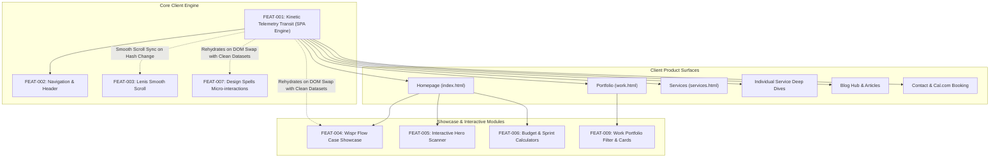

# FlexFlow Agency Portfolio - Feature Log & Dependency Graph

## Visual Architecture & Dependency Graph

## Feature Changelog & Status Tracking

| Feature ID | Feature Name | Status | Last Modified | Impact / Summary of Changes |
| :--- | :--- | :--- | :--- | :--- |
| **FEAT-001** | Kinetic Telemetry Page Transition | Resolved / Fixed | 2026-11-13 | Fixed `popstate` history resolution by adding `currentRenderedPath` state tracking and `cleanInitDatasets()` to rehydrate interactive spells on back/forward navigation. |
| **FEAT-004** | Wispr Flow Case Showcase | Updated | 2026-11-13 | Slide 0 (ABC Group) excised; Slide 1 (Voyage India) promoted to active Slide 0; Zara Salon shifted to Slide 1. |
| **FEAT-008** | Case Study Content (ABC Tile) | Removed | 2026-11-13 | ABC Tile completely removed from `index.html`, `work.html`, `performance-marketing.html`, `llms.txt`, `llms-full.txt`, and `vercel.json`. |
| **FEAT-009** | Work Portfolio Grid | Updated | 2026-11-13 | Removed `#abc-tile-ads` card; Voyage India promoted to lead performance case study. |
