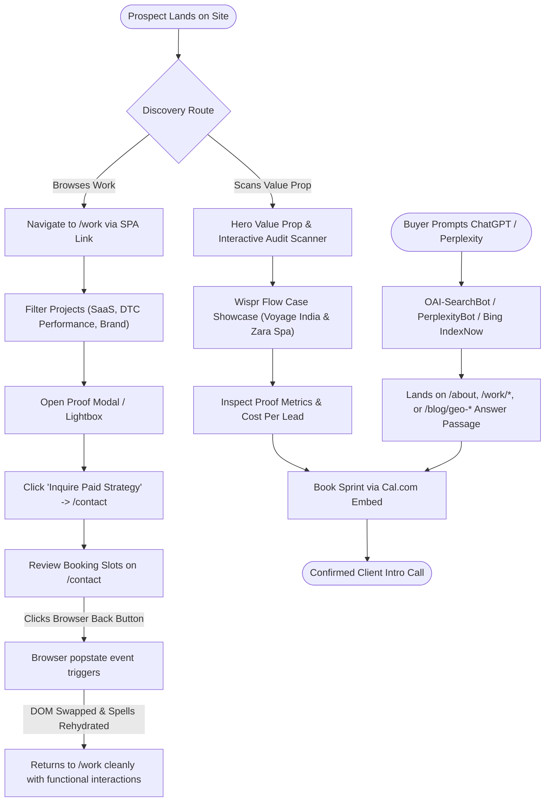

# FlexFlow Agency Portfolio - User Journeys

## Key User Journeys

## Detailed User Flow Steps

### Journey 1: Portfolio Review & History Traversal (Verified Functional)
1. Prospect visits `https://theflexflow.in/` or local dev server.
2. Prospect clicks "Work" in the top navigation bar.
3. Telemetry laser animation fires, `<main>` DOM swaps cleanly from `/` to `/work`, and `currentRenderedPath` updates to `'/work'`.
4. Prospect inspects direct-response performance case studies (Voyage India Travel, ABC Sleek Kitchen, Zara Salon).
5. Prospect clicks the browser **Back** button:
   - *Result*: The `popstate` listener fires `navigateTo(window.location.href, true)`.
   - *Resolution*: Because `targetPath` (`'/'`) differs from `currentRenderedPath` (`'/work'`), the engine recognizes a cross-page history navigation, fetches the homepage HTML, strips stale dataset flags via `cleanInitDatasets()`, swaps `<main>`, updates navigation active classes, resets scroll position, and rehydrates interactive design spells.
